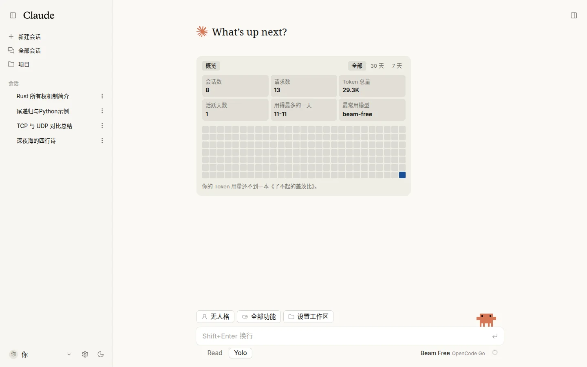
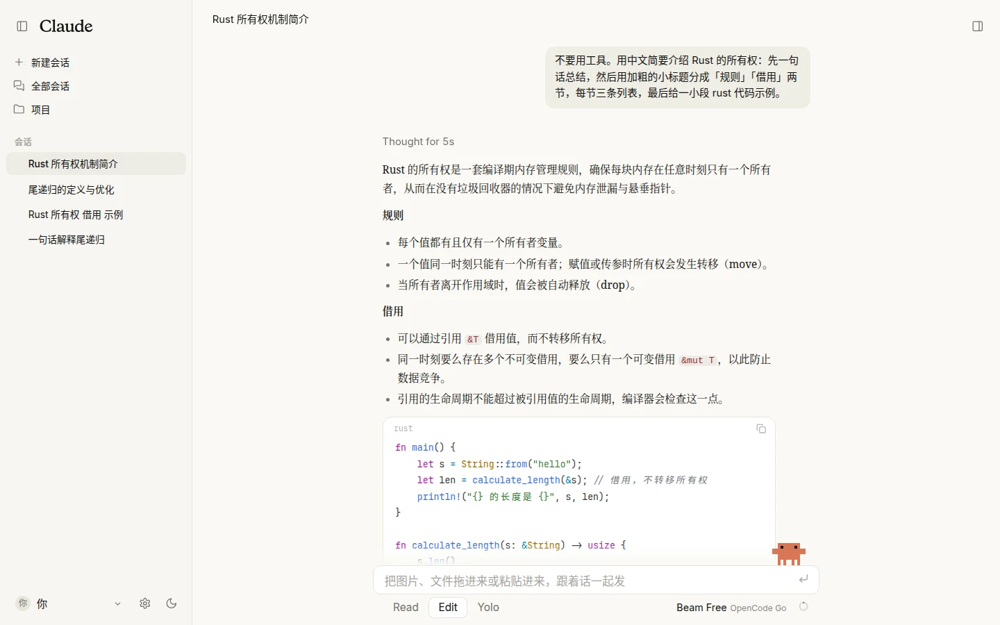

<p align="center">
  English | <a href="README.zh-CN.md">简体中文</a>
</p>

# Claude-style web skin (miyu-webui-theme-claude-style)

> <sub>This document was generated by Anthropic's Claude Fable 5.2.</sub>

This is an appearance package for the [Miyu](https://github.com/miyu-agent/miyu) web UI that imitates the look of the Claude web app: a white background, a clay-orange accent, answers set in a serif font, and a pixel crab named Clawd lying on top of the input box.

This package is ported from Nwflower's [dsh-claude-style](https://github.com/Nwflower/dsh-claude-style). The home page follows the layout of the original dsh (the greeting at the top, a usage card in the middle, the input box at the bottom), and the left column and the conversation page follow the look of the official claude.ai site.



| Conversation | Conversation · dark |
|---|---|
|  |  |

## Installing

Before you use this package, install the web UI (`webui`) first. Then run:

```sh
miyu pkg install webui-theme-claude-style
```

After installation, choose `Claude style` in `Settings → General → Theme` in the web UI; the color scheme and the mascot switch over with it. Afterwards you can still change the color scheme and the mascot separately.

## Changing the code

After you change the code, run `node --test tests/` in the root of the repository to test it (Node 22.7 or later is required; nothing else needs to be installed). When you release a new version, change `version` in `package.toml` and in `web/manifest.json` together; the tests check that the two are the same.

The tests also check whether any file tracked by git contains a path with a real user name (`tests/privacy.test.js`). Because the repository is public, when an example needs a home directory, use one of the made-up names listed in that file, for example `/home/alice`.

`web/sprite.js` (the mascot's player) and `web/body.js` (the mascot's body) exist as identical copies in this package and in the Deep Whale maid atelier web skin ([miyu-webui-theme-deep-whale](https://github.com/SHORiN-KiWATA/miyu-webui-theme-deep-whale)), so when you change one of them, change it in both packages. The tests compare them byte for byte with the files of the same name in the `miyu-webui-theme-deep-whale` directory next to this repository; you can also point to the other package's location with the environment variable `MIYU_THEME_PEER`. If you have not cloned the other package, these two tests are skipped. The web UI will provide shared modules in the future, and then the two files will no longer need a copy in each package.

## License

The code is licensed under MIT; see `LICENSE`. The fonts Inter and Noto Serif are licensed under the OFL. The Clawd frames and the Claude logo belong to Anthropic and are not covered by the MIT license; for details, see `NOTICE`.

The names and logos of Claude and Anthropic are trademarks of Anthropic PBC. This package is a third-party work; it is not affiliated with, endorsed by or sponsored by Anthropic.
