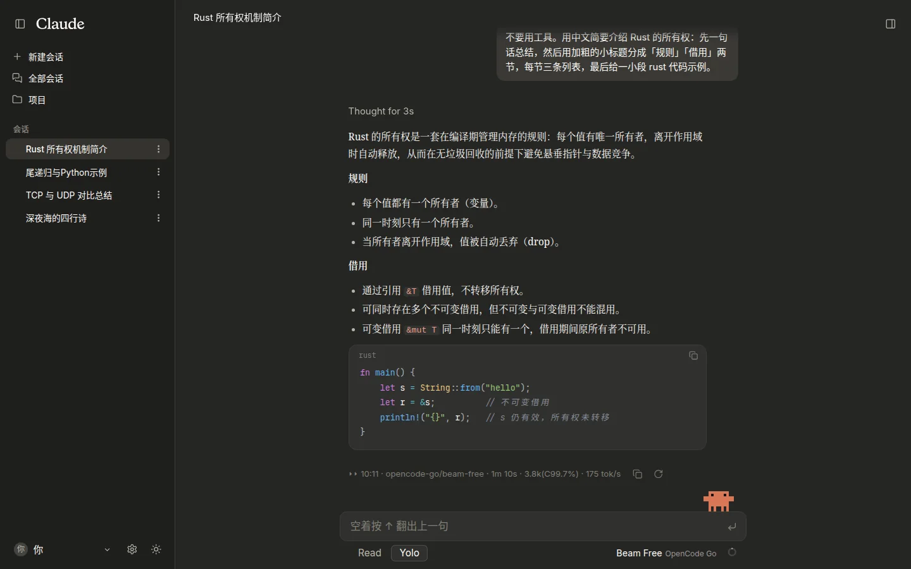

# miyu-webui-theme-claude-style · Claude 风格网页皮肤

[Miyu](https://github.com/miyu-agent/miyu) 网页界面的外观包：仿 Claude 网页的样子，白底、陶土橙、衬线字的回答，输入框上趴着一只像素螃蟹 Clawd。

移植自 Nwflower 的 [dsh-claude-style](https://github.com/Nwflower/dsh-claude-style)。首页照 dsh 原版（问候在顶、用量卡、输入框在底），左栏、对话页照 claude.ai 官网。


| 对话 | 对话 · 深色 |
|---|---|
|  |  |

## 装

```sh
miyu pkg install webui-theme-claude-style
```

装好后在网页的 设置 → 通用 → 主题 选「Claude 风格」，配色方案和吉祥物会一起切过去；配色、吉祥物也可以再单独换。要先装好网页界面（webui）。

## 改代码

改完在仓库根目录跑 `node --test tests/`（Node 22.7 以上，不用装别的）。发版时 `package.toml` 和 `web/manifest.json` 的 `version` 一起改，测试会核对两处一样。

测试还会检查被 git 跟踪的文件里有没有带真实用户名的路径（`tests/privacy.test.js`）。因为仓库是公开的，所以样例里要用家目录时，请写这个文件里列出的虚构名字，例如 `/home/alice`。

`web/sprite.js`（吉祥物的播放器）和 `web/body.js`（吉祥物的身子）在本包和大肥鱼深海女仆工坊网页皮肤（[miyu-webui-theme-deep-whale](https://github.com/SHORiN-KiWATA/miyu-webui-theme-deep-whale)）里各放一份，内容完全相同，所以改其中一处时要在两个包里同时改。测试会拿本仓库旁边 `miyu-webui-theme-deep-whale` 目录里的同名文件逐字节对比，也可以用环境变量 `MIYU_THEME_PEER` 指定另一个包的位置；如果没有克隆另一个包，这两条测试会跳过。以后网页界面会提供共享模块，到时这两个文件就不用各放一份了。

## 授权

代码 MIT（见 LICENSE）。字体 Inter、Noto Serif 是 OFL。Clawd 帧图和 Claude 的标志属于 Anthropic，不在 MIT 范围内，见 NOTICE。

Claude、Anthropic 的名称和标志是 Anthropic PBC 的商标。本包是第三方作品，与 Anthropic 没有关联，也没有经过 Anthropic 的认可或授权。

---

A Miyu web UI theme that looks like the Claude web app, ported from dsh-claude-style. Code MIT; Anthropic artwork excluded, see NOTICE. Claude, Anthropic and their logos are trademarks of Anthropic PBC. This is a third-party package, not affiliated with, endorsed by or sponsored by Anthropic.
