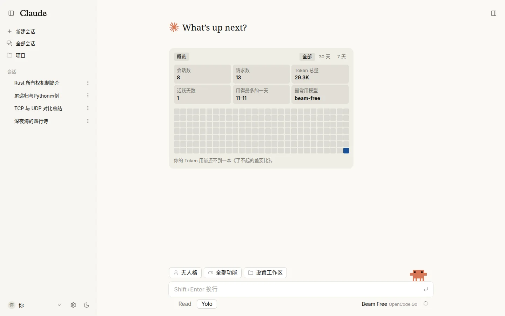
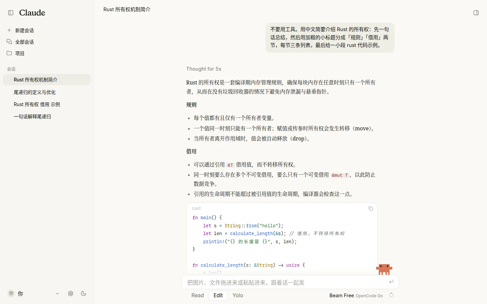
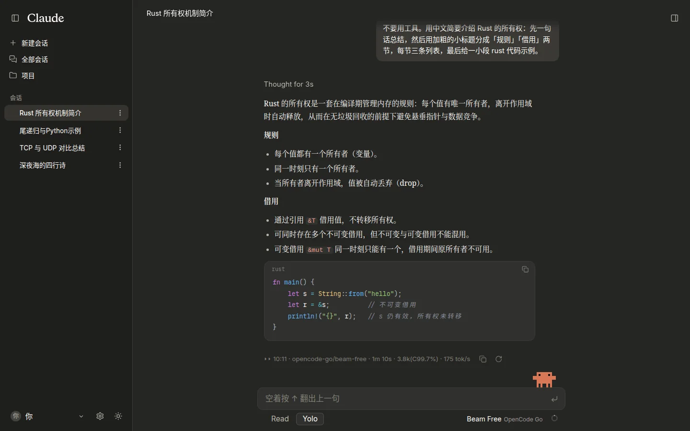

<p align="center">
  <a href="README.md">English</a> | 简体中文
</p>

# Claude 风格网页皮肤（miyu-webui-theme-claude-style）

> <sub>本文档由 Anthropic 的 Claude Fable 5.2 生成。</sub>

这是 [Miyu](https://github.com/miyu-agent/miyu) 网页界面的一个外观包，它模仿 Claude 网页的样子：白色的底、陶土橙的主色、用衬线字显示的回答，输入框上还趴着一只像素螃蟹 Clawd。

这个外观包移植自 Nwflower 的 [dsh-claude-style](https://github.com/Nwflower/dsh-claude-style)。首页仿照 dsh 原版的布局（问候在顶部、中间是用量卡片、输入框在底部），左栏和对话页仿照 claude.ai 官网的样子。



| 对话 | 对话 · 深色 |
|---|---|
|  |  |

## 安装

使用这个外观包之前，需要先安装网页界面（`webui`）。然后运行：

```sh
miyu pkg install webui-theme-claude-style
```

安装完成后，在网页界面的 `设置 → 通用 → 主题` 里选择 `Claude 风格`，配色方案和吉祥物会一起切换过去；之后也可以再单独更换配色方案和吉祥物。

## 修改代码

修改代码以后，在仓库根目录运行 `node --test tests/` 进行测试（需要 Node 22.7 以上，不需要安装其他依赖）。发布新版本时，`package.toml` 和 `web/manifest.json` 里的 `version` 要一起修改，测试会核对两处是否相同。

测试还会检查被 git 跟踪的文件里有没有带真实用户名的路径（`tests/privacy.test.js`）。因为仓库公开可见，所以样例里需要用到家目录时，请使用这个文件里列出的虚构名字，例如 `/home/alice`。

`web/sprite.js`（吉祥物的播放器）和 `web/body.js`（吉祥物的身体）在这个外观包和大肥鱼深海女仆工坊网页皮肤（[miyu-webui-theme-deep-whale](https://github.com/SHORiN-KiWATA/miyu-webui-theme-deep-whale)）里各有一份，内容完全相同，所以修改其中一份时，要在两个包里同时修改。测试会拿这个仓库旁边 `miyu-webui-theme-deep-whale` 目录里的同名文件逐字节对比，你也可以用环境变量 `MIYU_THEME_PEER` 指定另一个包的位置；如果没有克隆另一个包，这两条测试会被跳过。以后网页界面会提供共享模块，到那时这两个文件就不需要各放一份了。

## 许可证

代码使用 MIT 许可证，见 `LICENSE`。字体 Inter、Noto Serif 使用 OFL 许可证。Clawd 的帧图和 Claude 的标志属于 Anthropic，不在 MIT 许可证的范围内，详细的见 `NOTICE`。

Claude、Anthropic 的名称和标志是 Anthropic PBC 的商标。这个外观包是第三方作品，与 Anthropic 没有关联，也没有经过 Anthropic 的认可或授权。
